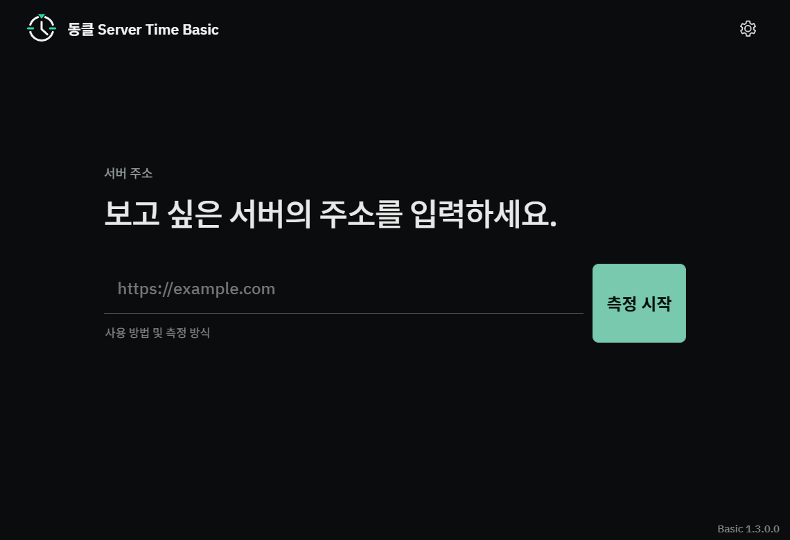

# 동클 DongClock · Windows 서버시간 참고 도구

서버시간 확인, 수강신청 준비, 티켓팅 준비를 위한 **무료 DongClock Basic**과 공식 사용 안내입니다. DongClock은 대상 웹사이트의 HTTP Date와 네트워크 왕복 시간을 관찰해 웹 응답의 시각을 추정하는 Windows 앱입니다.

**[무료 Basic 설치 · Microsoft Store](https://apps.microsoft.com/detail/9n0z8vz90sk6?cid=dc_ko_github_discovery01) · [공식 홈페이지](https://dongclock.com/?cid=dc_ko_github_discovery01) · [English website](https://dongclock.com/en.html?cid=dc_ko_github_discovery01)**

- **지원 환경:** Windows 10/11 x64 PC. 휴대폰에서는 웹 안내와 체크리스트를 이용할 수 있습니다.
- **시작 방법:** Basic 설치 → 확인할 공식 HTTP/HTTPS 주소 붙여넣기 → 측정 시작 → 시간과 함께 측정 상태·예상오차 확인.
- **저장소 범위:** 이곳은 공식 사이트의 HTML/CSS/JavaScript와 안내 문서를 관리하는 정적 웹사이트 저장소입니다. Windows 앱의 Rust 측정 엔진을 공개하는 소스 저장소는 아닙니다.



*실제 앱의 측정 전 화면입니다. 서버시간 측정 결과나 정확도 인증 화면이 아닙니다.*

## 목적에 맞는 무료 안내

| 필요한 것 | 바로 보기 |
| --- | --- |
| PC 시계와 서버시간의 차이, HTTP Date 읽는 법 | [서버시간 확인 안내](https://dongclock.com/server-time/?cid=dc_ko_github_discovery01) |
| 수강신청 일정·과목 코드·분반·대안 점검 | [수강신청 준비 체크리스트](https://dongclock.com/course-registration/?cid=dc_ko_github_discovery01) |
| 티켓 오픈 안내·인증·예매 완료 내역 점검 | [티켓팅 준비 체크리스트](https://dongclock.com/ticketing/?cid=dc_ko_github_discovery01) |
| 앱에 주소를 넣고 측정을 시작하는 순서 | [Basic 단계별 사용 가이드](https://dongclock.com/guide/?cid=dc_ko_github_discovery01) |

세 가지 준비 안내는 로그인 없이 사용할 수 있습니다. 체크와 메모는 기본적으로 저장하지 않으며, ‘이 브라우저에 저장’을 선택하면 현재 기기의 브라우저에 저장됩니다.

## 시간 표시를 참고할 때

학교·예매처의 공식 일정과 이용 규칙을 먼저 확인하세요. HTTP 응답의 Date는 서비스 내부의 신청·예매 판정 시각과 다를 수 있습니다. CDN·캐시와 네트워크 상태도 관측에 영향을 줍니다.

화면의 밀리초와 예상오차는 추정 표시입니다. 고정된 밀리초 정확도나 수강신청·티켓팅 성공을 보장하지 않습니다. 자동 클릭·자동 수강신청·구매 자동화 기능은 제공하지 않습니다. [정확도 및 한계](https://dongclock.com/accuracy/?cid=dc_ko_github_discovery01)에서 관측 범위를 확인할 수 있습니다.

## DongClock in English

**DongClock Basic is a free server-time reference app for Windows 10/11 x64.** It estimates a website response’s time using HTTP Date and network round-trip observations. Enter the official HTTP or HTTPS URL, start measurement, and read the measurement status and estimated error alongside the clock.

Use it as a reference while preparing for course registration or ticket booking. The service’s official schedule and rules remain the basis for your actions. HTTP response time may differ from the service’s internal registration or booking clock. Millisecond digits and estimated error do not guarantee millisecond accuracy or a successful registration or booking. DongClock does not automate clicks, registration, or purchases.

- [Install free Basic from Microsoft Store](https://apps.microsoft.com/detail/9n0z8vz90sk6?cid=dc_en_github_discovery01)
- [English website](https://dongclock.com/en.html?cid=dc_en_github_discovery01) · [Step-by-step Basic guide in English](https://dongclock.com/guide/en.html?cid=dc_en_github_discovery01)
- [Server-time guide](https://dongclock.com/server-time/?cid=dc_en_github_discovery01), [course-registration checklist](https://dongclock.com/course-registration/?cid=dc_en_github_discovery01), and [ticketing checklist](https://dongclock.com/ticketing/?cid=dc_en_github_discovery01) are in Korean.
- This repository contains the official static website built with HTML, CSS, and JavaScript. It is not the source repository for the Windows app’s Rust measurement engine.

## 공식 소식과 문의 · Official channels

[YouTube @Dongclock](https://www.youtube.com/@Dongclock) · [Instagram @dongclock2026](https://www.instagram.com/dongclock2026/) · [X @Dongclock2026](https://x.com/Dongclock2026) · [문의 / Contact](mailto:dongclock2026@gmail.com) · [버그·피드백 / Feedback](https://dongclock.com/feedback/?cid=dc_en_github_discovery01)

---

# DongClock Server Time website

DongClock Server Time의 한국어·영어 공식 제품 소개용 정적 사이트입니다. 빌드 도구나 외부 프레임워크 없이 HTML/CSS/JavaScript만 사용하므로 GitHub Pages에 그대로 배포할 수 있습니다.

## 파일 구조

```text
dongclock-site/
├─ index.html
├─ en.html
├─ terms/index.html
├─ privacy/index.html
├─ refund/index.html
├─ accuracy/index.html
├─ open-source/index.html
├─ open-source/THIRD-PARTY-NOTICES.txt
├─ MICROSOFT-STORE-LISTING-COPY.md
├─ downloads/basic/1.1.0/  # 기존 직접 배포 파일 보관; 홈페이지에서 미노출
├─ CNAME
├─ sitemap.xml
├─ robots.txt
├─ styles.css
├─ script.js
├─ README.md
└─ assets/
   ├─ dongclock-icon.png
   └─ screenshots/
      └─ basic-app.png
```

- `index.html`: 한국어 기본 페이지
- `en.html`: 영어 페이지
- 두 페이지의 헤더에서 언어를 전환할 수 있습니다.
- 다섯 법적/제품 고지 페이지는 각 URL 안에 한국어와 영어를 모두 포함하며, 언어 링크는 같은 문서의 해당 언어 섹션으로 이동합니다.
- `MICROSOFT-STORE-LISTING-COPY.md`: Microsoft Store Basic/Pro 상품 설명과 실제 상품 링크를 정리한 운영 문서입니다.

## 자주 바꾸는 설정

`script.js` 상단의 `SITE_CONFIG` 한 곳에서 관리합니다.

- `version`: 사이트에 표시할 제품 버전
- `microsoftStoreBasicUrl`: Basic Microsoft Store 상품 URL
- `microsoftStoreProUrl`: Pro Microsoft Store 상품 URL

Basic과 Pro 모두 실제 Microsoft Store 상품 주소를 사용합니다. Basic: `https://apps.microsoft.com/detail/9n0z8vz90sk6?ocid=webpdpshare`, Pro: `https://apps.microsoft.com/detail/9ph3wmbzpq50?hl=ko-KR&gl=KR`.

Basic은 무료로 안내하며, Pro의 가격과 구매 조건은 국가·지역별 Microsoft Store 상품 페이지에서 확인하도록 표시합니다. Store 상품 정보가 확정되기 전에는 고정 가격이나 라이선스 기간을 홈페이지와 JSON-LD에 추가하지 않습니다.

`downloads/`에는 과거 직접 배포 파일이 남아 있지만 홈페이지에서는 링크하지 않습니다. 삭제 전에는 기존 배포·지원 목적을 별도로 확인해야 합니다.

## 이미지 교체

- 앱 아이콘 및 사이트 favicon: `assets/dongclock-icon.png`
- 제품 화면: `assets/screenshots/basic-app.png`

현재 페이지는 아이콘과 실제 Basic 제품 화면을 사용합니다. Open Graph 이미지에는 공식 사이트의 아이콘 절대 URL이 설정되어 있습니다.

## 로컬 미리보기

프로젝트 폴더에서 간단한 정적 서버를 실행합니다.

```powershell
python -m http.server 8000
```

브라우저에서 `http://localhost:8000`을 엽니다. Python이 없다면 VS Code Live Server 등 아무 정적 서버를 사용해도 됩니다.

## GitHub Pages 배포

### 저장소 루트에 배포하는 경우

1. 이 폴더의 파일을 GitHub 저장소 루트에 둡니다.
2. GitHub 저장소의 **Settings → Pages**로 이동합니다.
3. **Build and deployment**에서 **Deploy from a branch**를 선택합니다.
4. 배포 branch(보통 `main`)와 `/(root)`를 선택하고 저장합니다.

### `docs/` 폴더로 배포하는 경우

1. 이 폴더의 내용 전체를 저장소의 `docs/`로 복사합니다.
2. **Settings → Pages**에서 배포 branch와 `/docs`를 선택합니다.

사이트는 상대 경로만 사용하므로 GitHub Pages project URL과 custom domain 루트에서 모두 동작합니다. 공식 canonical URL은 `https://dongclock.com/`입니다.

### Custom domain과 robots.txt

배포 루트의 `CNAME`은 GitHub Pages custom domain을 `dongclock.com`으로 유지합니다. custom domain이 적용되면 같은 배포 루트의 `robots.txt`는 `https://dongclock.com/robots.txt`로 제공되며 `https://dongclock.com/sitemap.xml`을 선언합니다. `www.dongclock.com`으로 접근할 수 있도록 DNS를 추가하더라도 모든 canonical과 sitemap URL은 apex 도메인인 `https://dongclock.com/`을 사용합니다.

## 배포 전 점검

- `SITE_CONFIG.microsoftStoreBasicUrl` 설정 여부
- `SITE_CONFIG.microsoftStoreProUrl` 설정 여부
- Store 상품 페이지의 Pro 가격·구매 형태·이용 권한 조건
- 제품 버전과 Windows 지원 범위
- Microsoft Store용 앱의 이용 권한 확인 및 개인정보 데이터 흐름
- canonical, Open Graph URL과 `sitemap.xml`의 공식 배포 주소
- 아이콘과 스크린샷 파일이 함께 배포되는지

## 문구 검증 기준

페이지의 측정·제품 설명은 저장소의 `PROJECT_CONTEXT.md`, `DECISIONS.md`, `CHANGELOG_DEV.md`와 Basic/Pro Rust production source를 기준으로 작성했습니다. 정확도 보장, 절대 UTC 인증, 무부하, 원자시계 수준 등의 표현은 사용하지 않습니다.
